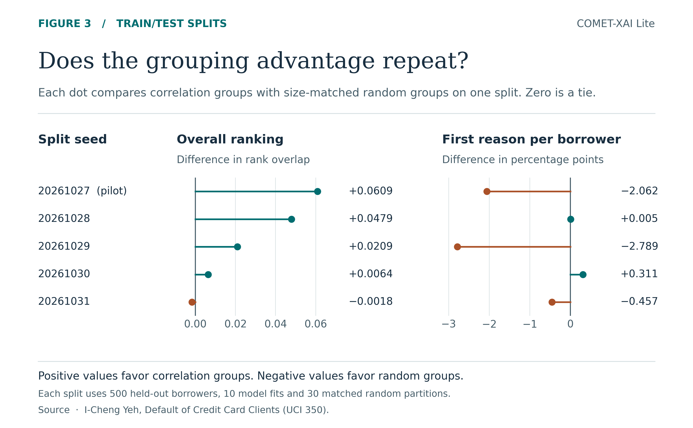

# Five-split explanation stability experiment

## Results

Correlation grouping improved the overall ranking on **three of the four new
splits**. Its mean advantage on the new splits was **+0.0184** in rank overlap,
compared with **+0.0609** in the pilot. The first-reason result changed
direction. Two new splits favored correlation grouping (+0.005 and +0.311
percentage points) and two favored random grouping (−2.789 and −0.457 points).
The +0.005-point difference was effectively a tie. Averaged across the four new
splits, first-reason agreement was **0.732 percentage points lower** with
correlation grouping.

| Split seed | Overall rank overlap, correlation | Overall rank overlap, random | Difference | Same first reason, correlation | Same first reason, random | Difference (percentage points) | Median bill cancellation |
| --- | ---: | ---: | ---: | ---: | ---: | ---: | ---: |
| 20261027 (pilot) | 0.9240 | 0.8631 | +0.0609 | 78.489% | 80.551% | −2.062 | 85.6% |
| 20261028 | 0.9038 | 0.8559 | +0.0479 | 77.116% | 77.110% | +0.005 | 90.7% |
| 20261029 | 0.8926 | 0.8717 | +0.0209 | 78.542% | 81.332% | −2.789 | 88.9% |
| 20261030 | 0.8702 | 0.8638 | +0.0064 | 79.804% | 79.493% | +0.311 | 88.2% |
| 20261031 | 0.8414 | 0.8432 | −0.0018 | 74.351% | 74.808% | −0.457 | 88.3% |

Differences use unrounded scores. Across all five splits, the overall ranking
difference ranged from −0.0018 to +0.0609, and the first-reason difference
ranged from −2.789 to +0.311 percentage points. Median bill cancellation was
high on each split (85.6–90.7%). These ranges describe repeated splits of one
dataset using one model family.



[Vector PDF](../../figures/figure-3-split-stability.pdf) · [Full-precision results](per_split.csv) · [Protocol committed before the four new runs](https://github.com/prk0024/btech-minor-proj-dhedhan/commit/2f529e182eb95ee4d2eb0eff58e4e85e34f6c6fd)

## Protocol

Use five stratified 80/20 train/test splits on the UCI Default of Credit Card
Clients data. Seed **20261027** reproduces the published pilot. The four new
seeds are **20261028, 20261029, 20261030 and 20261031**, chosen consecutively
before running them. Include every split and give the original pilot its own
label.

Change only the train/test split seed in the root pilot. On each split, learn
groups on the 24,000 training records using complete linkage and an absolute
Spearman correlation threshold of 0.7. Keep those groups fixed across the ten
bootstrap logistic fits (seeds 0–9, C = 1). Select 500 of the 6,000 held-out
borrowers with seed 20. Use the same borrowers and 45 refit pairs for both
grouping methods. The control is the mean over 30 random partitions with
exactly the learned group sizes, generated with seed 101.

For each split, report both methods' overall rank-biased overlap (0–1,
p = 0.85) and borrower-level agreement on the first-ranked group. Calculate
each difference as correlation grouping minus the matched random mean. Express
the first-reason difference in percentage points and take its direction before
rounding. Also report the median cancellation fraction for the six-month bill
group over the 5,000 borrower–fit pairs.

Report the range and direction of the differences, identifying any reversal
relative to the pilot. All five splits reuse the same source population and
can share borrowers. Interpret the differences descriptively.

## Reproduction

From the repository root, run the following command.

```bash
uv run --no-project --python 3.12 --with-requirements requirements.txt python repeat_splits.py
```

The printed run directory contains `per_split.csv`, Figure 3 (PNG and PDF), and a directory for each
seed with its train/test/audit row indices, model metrics, groups and
borrower-level calculations. Fractions in the CSV are on a 0–1 scale except
for `delta_top1_pp`, which is in percentage points.
